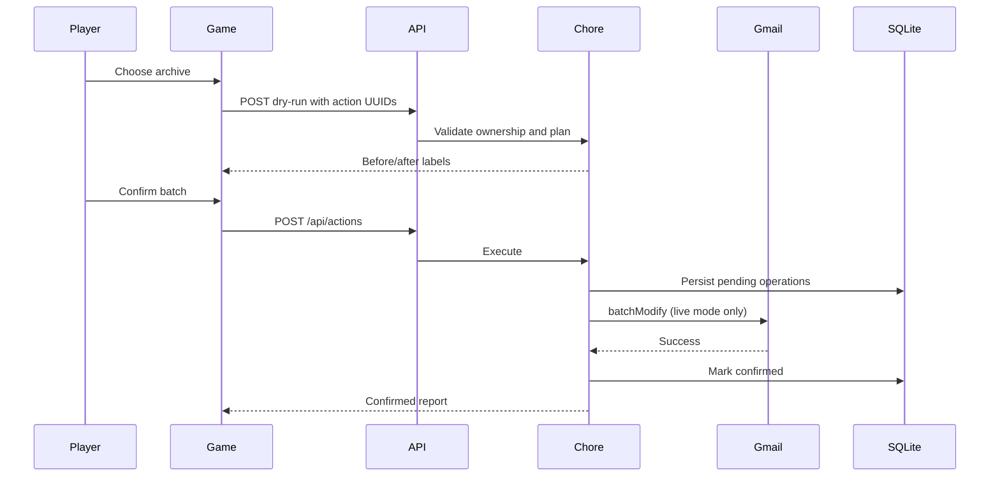

# Chore Arcade: high-level design

One repository and container: Express serves the React build and REST API.
The browser never receives Google tokens. Google OAuth authorization-code flow
uses a one-time state bound to an HTTP-only cookie. Only gmail.modify is requested;
it includes reading and modifying messages. Permanent deletion is not supported.

## Data flow

Browser -> routes -> controllers -> chore service -> models -> SQLite.
The live adapter calls Gmail; demo mode updates isolated SQLite mock messages.
Decisions are queued locally, previewed, then applied in a batch on confirmation.
Score counts confirmed operations, never browser-submitted point totals.

## Deployment constraints

SQLite is durable locally, but Cloud Run's writable filesystem is ephemeral.
This build's Cloud Run deployment is explicitly a single-instance demo preview:
records reset on replacement/restart, and live token encryption keys are process-local.
Do not use it as a durable production Gmail service. A durable database migration,
stable managed encryption key, OAuth verification, and multi-instance locking are
required before production live use. Do not mount SQLite on a bucket as a shortcut.

## Safety and scope

No delete action. Undo reverses only labels changed by the action.
Per-session isolation, request validation, secure production cookies, same-origin
mutation checks, content security policy, request limits, and server-only secrets.
Demo results and leaderboard entries are labeled. OAuth configuration is optional.
Gemini, folder sorting, and lint fixing are deferred optional features.
